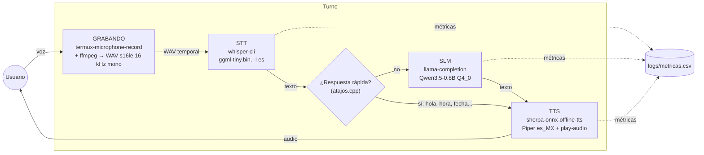
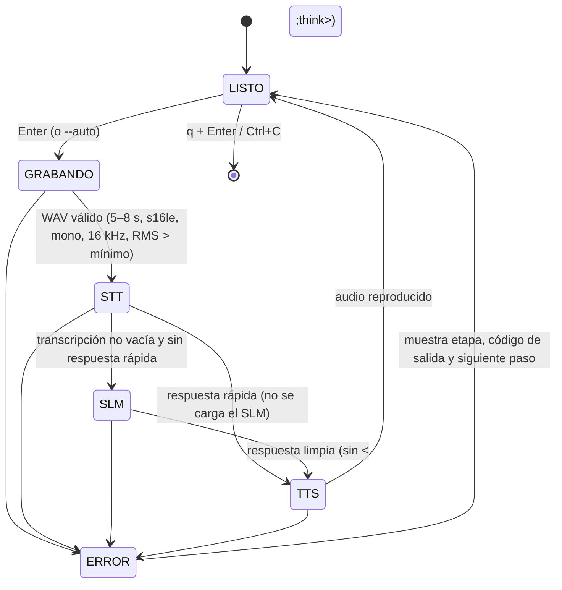

# Arquitectura de Jarvis-son V1

## Visión general

Jarvis-son es un **orquestador en C++17** que ejecuta, por turnos y en serie, cuatro programas
externos. Cada programa es un **proceso hijo** que carga su modelo, hace su trabajo y termina, de
modo que **nunca hay dos modelos en memoria a la vez** (requisito clave para un teléfono de 3 GB).



## Máquina de estados



Las transiciones válidas están codificadas en `transicion_valida()` (`src/estados.cpp`) y probadas
en `tests/unit/prueba_estados_metricas.cpp`.

Cuando una etapa falla, el orquestador imprime:

```
[ERROR] Etapa: SLM | Código de salida: 42
  Detalle: .../llama-completion: código de salida 42
  stderr (últimas líneas): ...
  Siguiente paso: Pruebe bash scripts/probar_slm.sh. Si dice 'unknown model architecture' ...
```

Códigos especiales: `124` = tiempo límite superado, `127` = binario no encontrado,
`128+N` = terminado por la señal N (`137` = SIGKILL, típico del OOM killer de Android),
`130` = cancelado con Ctrl+C.

## Módulos

| Archivo | Responsabilidad |
|---|---|
| `proceso.{hpp,cpp}` | `ejecutar(argv, opciones)`: `fork` + `execvp`, captura stdout/stderr con `poll`, tiempo límite, grupo de procesos propio, `wait4` + `rusage.ru_maxrss` para memoria pico |
| `util.{hpp,cpp}` | `DirTemporal` (mkdtemp + borrado automático), lectura/escritura de archivos |
| `json.{hpp,cpp}` / `config.{hpp,cpp}` | Lector JSON sin dependencias; carga y valida perfiles |
| `estados.{hpp,cpp}` | Estados, transiciones válidas y formato del error |
| `diagnostico.{hpp,cpp}` | Traduce el resultado de un proceso a "siguiente paso" |
| `wav.{hpp,cpp}` | Lee cabecera WAV, duración y RMS; valida formato para whisper |
| `texto.{hpp,cpp}` | Sanea texto, limpia salida de whisper y de llama (`<think>`, marcas) |
| `captura.{hpp,cpp}` | Etapa GRABANDO |
| `stt.{hpp,cpp}` | Etapa STT |
| `slm.{hpp,cpp}` | Etapa SLM |
| `tts.{hpp,cpp}` | Etapa TTS (+ respaldo `termux-tts-speak` solo de demostración) |
| `metricas.{hpp,cpp}` | Escribe `logs/metricas.csv` |
| `atajos.{hpp,cpp}` | Respuestas rápidas: normaliza la frase, la compara con las reglas de `config.json` (exacta o palabras clave, con tolerancia a 1 error) y responde sin SLM; hora/fecha dinámicas y temas bloqueados |
| `orquestador.{hpp,cpp}` | Encadena las etapas y aplica la máquina de estados |
| `main.cpp` | Argumentos de línea de comandos y bucle de turnos |

## Seguridad: cómo se lanzan los procesos

- **Prohibido** `system()`, `popen()` o construir comandos de shell. La CI falla si aparecen.
- Cada etapa arma un `std::vector<std::string>` con **argv fijo**; las rutas vienen de
  `config.json` y los números se validan por rango al cargarla.
- El **texto del usuario**:
  - STT → SLM: se escribe en un archivo temporal y `llama-completion` lo lee con `-f`.
  - SLM → TTS: se pasa a `sherpa-onnx-offline-tts` como **un único argumento** final, ya saneado
    (sin caracteres de control y sin guiones iniciales, para que no parezca una opción).
  - Respaldo `termux-tts-speak`: el texto va por **stdin**.
- Los hijos se ejecutan en su propio grupo de procesos; ante tiempo límite o Ctrl+C se envía
  `SIGTERM` y luego `SIGKILL` a todo el grupo.

## Memoria y tiempos

`wait4()` devuelve `rusage.ru_maxrss` (KB en Linux/Android) del hijo, que es su **memoria residente
pico**. Como las etapas son secuenciales, la memoria máxima del sistema es aproximadamente la del
hijo más grande (normalmente `llama-completion`) más el orquestador (~unos MB).

Columnas de `logs/metricas.csv`:

```
fecha,perfil,turno,estado,etapa_error,codigo_error,ms_grabacion,ms_conversion,ms_stt,ms_slm,
ms_tts,ms_reproduccion,ms_total,duracion_audio_s,rtf_stt,rss_ffmpeg_kb,rss_stt_kb,rss_slm_kb,
rss_tts_kb,motor_tts,ruta
```

`ruta` = `slm` (pasó por Qwen), `atajo` (respuesta rápida) o `bloqueo` (tema bloqueado).

`rtf_stt` = tiempo de whisper / duración del audio (menor que 1 = más rápido que tiempo real).

## Archivos temporales

Cada turno crea `$TMPDIR/jarvis-turno-XXXXXX/` con `entrada16k.wav`, `transcripcion.txt`,
`sistema.txt`, `usuario.txt` y `respuesta.wav`. El directorio se borra al terminar el turno, **haya
éxito o error** (destructor de `DirTemporal`). La grabación original `.m4a` se borra apenas se
convierte.
